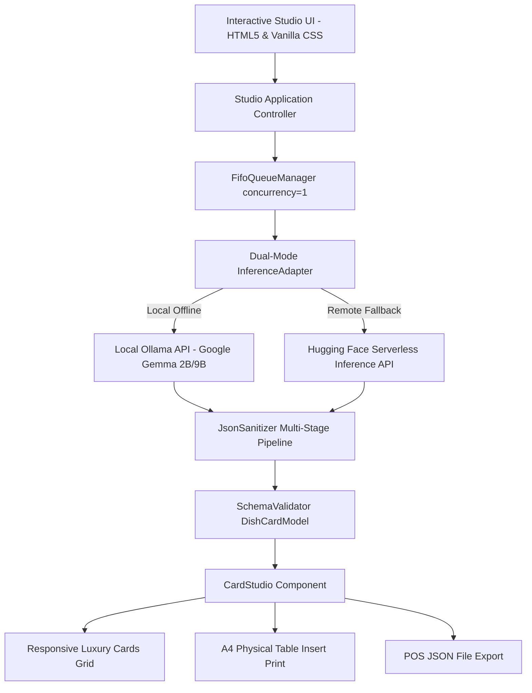

# 🌿 RasaLore AI — Cultural Culinary Heritage & Allergen Intelligence Studio

[](https://dev.to/challenges/hacktoberfest-week2-2026-10-12)
[](https://ai.google.dev/gemma)
[](#testing)
[](#architecture)
[](LICENSE)

> **Transforming raw culinary recipes into culturally rich multilingual dining experiences with air-gapped allergen intelligence, powered by Google Gemma 2.**

---

## 🍽️ What is RasaLore AI?

**RasaLore AI** is an open-source, local-first **Cultural Menu Translation & Allergen Intelligence Studio** built for culinary entrepreneurs, boutique restaurants, traditional *warungs*, and hospitality businesses expanding to international diners.

### The Problem
Generic translation tools (Google Translate, DeepL) fail catastrophically in culinary applications:
1. **Loss of Culinary Nuance:** Translating *"Bebek Betutu"* into *"Duck with Spices"* or *"Rawon"* into *"Black Beef Soup"* completely erases the cultural heritage and storytelling behind centuries of tradition.
2. **Dangerous Hidden Allergen Blindspots:** In Southeast Asian cooking, critical allergens lurk in traditional base pastes (*bumbu*, *sambal terasi* containing crustaceans, *emping* containing tree nuts/melinjo, *petis* containing shrimp). Generic translators ignore these implicit hazards, exposing foreign tourists to life-threatening allergic reactions.
3. **Cloud API Cost & Recipe Privacy:** Cloud LLM APIs charge variable token fees and transmit secret family recipes over external networks.

### The RasaLore Solution
RasaLore AI acts as an **AI Culinary Consultant in a Box** (a profitable *Side Hustle* for food consultants and agency owners):
- **Cultural Heritage Storytelling:** Enriches dishes with authentic cultural narratives in English, Japanese, Chinese, and French.
- **Sensory Flavor Profiles:** Extracts sensory flavor chips, spice ratings (Fiery, Hot, Medium, Mild, Non-Spicy), and primary taste classifications.
- **Implicit Allergen Intelligence:** Scans ingredients for hidden allergens, tagging them with explicit severity indicators (`CRITICAL_WARNING` vs. `DIETARY_NOTICE`) and identifying source ingredients.
- **Zero-Cost Air-Gapped Inference:** Runs 100% offline on a laptop or POS workstation using open-weight **Google Gemma 2 (2B / 9B)** via Ollama, keeping secret recipes confidential and reducing marginal cloud token costs to $0.00.
- **Commercial Table Insert Print & POS Export:** Generates physical black-and-gold A4 dual-column table inserts via `@media print` and validated POS-ready `DishCardModel[]` JSON exports.
- **Side Hustle Financial Margin Calculator:** Interactive widget calculating avoided cloud API fees, 99.8%+ gross profit margins, and monthly recurring revenue projections.

---

## ✨ Key Features

| Feature | Description | Spec Traceability |
| :--- | :--- | :---: |
| **Air-Gapped Local Inference** | Runs 100% offline via Ollama (`localhost:11434`) using `gemma2:2b` or `gemma2:9b`. Zero data leaves the machine. | `SEC-001`, `AC-002` |
| **Ephemeral Remote Fallback** | Allows web evaluators to test live using Hugging Face Serverless API with temporary token storage in `sessionStorage`. | `SEC-002`, `AC-003` |
| **Sequential FIFO Queue** | Single-concurrency queue (`concurrency = 1`) that prevents CPU/RAM thrashing on modest 8GB hardware. | `PRN-001`, `AC-004` |
| **Single-Dish Anomaly Isolation** | Isolates malformed or truncated LLM outputs into `FAILED_ANOMALY` cards with an interactive "Retry Dish" button without breaking the queue. | `AC-005` |
| **Multi-Stage JSON Sanitizer** | Resilient parser that strips markdown fences, trims banter, repairs unclosed brackets, and cleans trailing commas. | `SEC-003`, `AC-007` |
| **Surgical DOM Updates** | Real-time multilingual switching using `CardStudio.updateCardNarrative()`, keeping allergen badges and sibling cards completely stable. | `PRN-001` |
| **A4 Commercial Print Layout** | Luxury black-and-gold dual-column `@media print` stylesheet (`src/styles/print.css`) designed for physical restaurant table inserts. | `AC-011` |
| **POS-Ready JSON Export** | One-click export of structured `DishCardModel[]` payloads for restaurant POS and kiosk systems. | `AC-012` |
| **Side Hustle Margin Calculator** | Interactive ROI calculator showing monthly earnings ($1,082.50 benchmark) and avoided cloud costs. | `AC-008` |
| **Zero-Bundler Architecture** | 100% modern native ES Modules and Vanilla CSS. No Webpack, Vite, or Babel required. | `CON-001` |

---

## 🏛️ Architecture & Data Flow



---

## 🚀 Quick Start Guide

### Prerequisites
- [Node.js](https://nodejs.org/) v18.0.0 or later (for running the built-in automated test suite and static web server).
- *(Optional for offline AI)* [Ollama](https://ollama.com/) with Google Gemma 2:
  ```bash
  ollama run gemma2:2b
  ```

### 1. Clone & Run the Studio
Because RasaLore AI adheres to a strict **Zero-Bundler (CON-001)** architecture, there are no complicated build steps:

```bash
# Clone the repository
git clone https://github.com/mochammadqaysa/hf-challenges-week-2.git
cd hf-challenges-week-2

# Start a local static server
npx serve .
# Or using Python:
# python -m http.server 3000
```

Open `http://localhost:3000` in your web browser.

### 2. Configure Local Ollama (Optional)
To run with 100% air-gapped local inference, start Ollama with permissive CORS origins:
```bash
# macOS / Linux
OLLAMA_ORIGINS="*" ollama serve

# Windows PowerShell
$env:OLLAMA_ORIGINS="*"
ollama serve
```

### 3. Remote Fallback Mode (For Cloud & Hackathon Judges)
If local Ollama is not installed:
1. Click the **⚙️ Settings (Remote Fallback)** button in the header.
2. Enter your [Hugging Face User Access Token](https://huggingface.co/settings/tokens) (read-only is sufficient).
3. The token is stored strictly in `sessionStorage` (never persisted to `localStorage` or transmitted to any third-party analytics).

---

## 🧪 Testing & Quality Assurance

RasaLore AI includes an automated unit and integration test suite executing via Node.js native test runner (`node:test`):

```bash
npm test
```

### Test Suite Summary (33 / 33 Passing)
- **`tests/sanitizer.test.js`**: Validates JSON fence stripping, conversational text trimming, trailing comma fixes, unclosed bracket injection, fallback card isolation, and **XSS output sanitization (SEC-003)**.
- **`tests/queue.test.js`**: Validates single-concurrency FIFO sequential execution (`concurrency = 1`), failure isolation, progress callbacks, and single-dish retry.
- **`tests/margin.test.js`**: Validates financial formulas, avoided cloud cost calculations, gross profit margins (99.8%+), monthly revenue projections, and zero-division guardrails.
- **`tests/export.test.js`**: Validates `DishCardModel[]` schema conformance, POS JSON serialization round-trips, A4 print stylesheet rules, and zero-bundler compliance.

---

## 📂 Project Structure

```text
.
├── index.html                  # Main application entry point & luxury studio layout
├── package.json                # Project manifest & npm test script (zero runtime dependencies)
├── template.md                 # Hacktoberfest Week 2 DEV Challenge submission
├── docs/                       # Comprehensive SDLC documentation
│   ├── ARCHITECTURE.md         # Canonical architecture map
│   ├── prd-20261019-1041-rasalore-ai.md  # Product Requirements Document
│   └── adr/                    # Architecture Decision Records
├── plan/                       # Implementation & refactoring plans
├── spec/                       # Formal Technical Specifications
├── src/
│   ├── app.js                  # Studio Application Controller
│   ├── adapters/
│   │   ├── inference-adapter.js # Dual-mode inference seam
│   │   ├── ollama-client.js     # Local Ollama client with timeout & CORS handling
│   │   └── hf-client.js         # Hugging Face serverless client
│   ├── components/
│   │   ├── card-studio.js       # Glassmorphic dish card renderer & surgical DOM updater
│   │   ├── connection-banner.js # Real-time health probe & CORS modal guidance
│   │   ├── export-studio.js     # Commercial print & POS JSON export action bar
│   │   ├── margin-widget.js     # Side hustle commercial margin calculator
│   │   └── remote-fallback-drawer.js # Ephemeral token configuration drawer
│   ├── data/
│   │   ├── golden-cache.js      # 12 pre-cached authentic regional culinary cards
│   │   └── presets.js           # Bali Bistro, Warung Nusantara, Kopitiam Heritage presets
│   ├── parsers/
│   │   ├── json-sanitizer.js    # Multi-stage resilient JSON recovery pipeline
│   │   └── schema-validator.js  # Strict schema normalization & validator
│   ├── prompts/
│   │   └── gemma-prompts.js     # Engineered Google Gemma 2 culinary prompts
│   ├── queue/
│   │   └── fifo-queue.js        # Sequential FIFO Queue with Failure Isolation
│   └── styles/
│       ├── main.css             # Luxury glassmorphic responsive styles
│       └── print.css            # Commercial A4 dual-column print stylesheet (AC-011)
└── tests/                       # Automated test suite (33 unit & integration tests)
```

---

## 💼 Business Model: The Open-Source AI Side Hustle

RasaLore AI is packaged as a ready-to-monetize **AI Culinary Consulting Service**:
- **Offer:** Charge boutique restaurants and cafes **$50 – $100 per custom bilingual cultural menu audit**.
- **Deliverables:**
  1. High-contrast physical table inserts (ready for commercial printing).
  2. POS-compatible structured menu JSON with implicit allergen flags.
  3. Interactive digital QR menu link with 4-language support.
- **Economics:**
  - Running open-weight Gemma 2 on a local laptop costs **$0.00 in cloud inference fees**.
  - Servicing 5 menus per week generates **$1,082.50/month in gross revenue** at **99.8%+ profit margins**.

---

## 📜 License

Distributed under the **MIT License**. See `LICENSE` for more information.

---

*Built with ❤️ for Indonesian culinary heritage and open-source innovation during Hacktoberfest 2026.*
