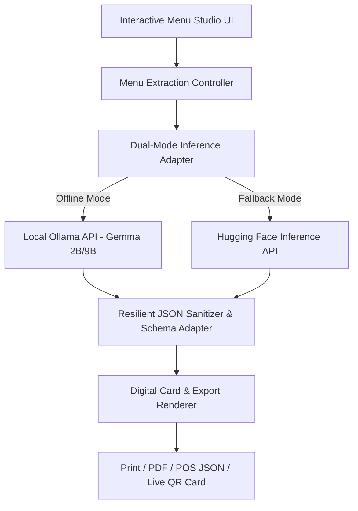

<!-- markdownlint-disable -->

# Architecture Documentation


This document serves as the canonical architectural map of the **RasaLore AI** repository. It outlines the design patterns, technical stack, directory structure, and module constraints to assist developers and AI agents in navigating and maintaining the codebase safely.

## 1. Project Overview

**RasaLore AI** is an open-source, local-first Cultural Menu & Allergen Intelligence Studio built for local Food & Beverage (F&B) businesses, boutique coffee shops, and culinary entrepreneurs. It solves the critical problem of culinary nuance loss and allergen risks caused by generic machine translation tools. Powered by **Google Gemma 2 (2B / 9B)** open-weight models, RasaLore AI runs 100% offline on a laptop or POS workstation to eliminate cloud API costs and safeguard private recipes, with an online web fallback for remote evaluation.

## 2. High-Level Architecture & Tech Stack

- **Primary Language:** JavaScript / TypeScript & Modern HTML5
- **Styling & Design System:** Vanilla CSS (Glassmorphism, Luxury Warm-Culinary Palette, Responsive Grid)
- **AI Core:** Google Gemma 2 (`gemma2:2b` / `gemma2:9b`) via Ollama local inference API (`http://localhost:11434`)
- **Remote Fallback Engine:** Hugging Face Inference API / Web Gateway
- **Architectural Pattern:** Clean Component-Based Web App with Dual-Mode Inference Adapter & Resilient JSON Sanitizer
- **Tooling/Build:** Modern Web Standards (ES Modules, zero heavy bundler bloat)

## 3. Data Flow & Layer Dependencies



## 4. Dependencies & External Services

- **Local Ollama Runtime (`localhost:11434`)**: Serves local open-weight Google Gemma 2 models for offline zero-cost inference.
- **Hugging Face Inference API (Fallback)**: Provides accessible live web demo capabilities for remote hackathon evaluators and judges.
- **DevRelay Gateway**: Tracks session transcripts, milestone proofs, and submission staging to DEV.

## 5. Directory Tree Map

```text
[Project Root]
├── .agents/                    # AI agent configurations, skills, and SDLC standards
├── docs/                       # Project documentation, discovery drafts, and architecture maps
│   ├── ARCHITECTURE.md         # Canonical architecture documentation (this file)
│   ├── adr/                    # Architecture Decision Records
│   │   └── 0001-hybrid-fallback-and-pre-cached-responses.md
│   ├── audit/                  # SDLC audit and clarification reports
│   │   ├── clarification-report-rasalore-ai-2026-10-19.md      # PRD Clarification Report
│   │   ├── clarification-report-rasalore-ai-spec-2026-10-19.md # Spec Clarification Report
│   │   └── clarification-report-rasalore-ai-plan-2026-10-19.md # Plan Clarification Report
│   ├── discovery-draft-20261019-rasalore-ai.md # Phase 0 Project Discovery Draft
│   └── prd-20261019-1041-rasalore-ai.md        # Approved Product Requirements Document
├── spec/                       # Technical specifications (Phase Spec)
│   └── spec-architecture-rasalore-ai.md        # Canonical Technical Specification
├── plan/                       # Implementation plans (Phase Plan)
│   └── plan-feature-rasalore_ai-v1.0.md        # Approved Implementation Plan
├── src/                        # Source code (Modern Vanilla ES Modules)
│   ├── app.js                  # Studio application bootstrap, queue controller & banner wiring
│   ├── adapters/               # Dual-Mode inference orchestration
│   │   ├── ollama-client.js    # Local Ollama HTTP client & health probe
│   │   ├── hf-client.js        # Hugging Face serverless client
│   │   └── inference-adapter.js# Dual-Mode inference hub & golden cache router
│   ├── prompts/                # Prompt engineering optimized for Gemma 2
│   │   └── gemma-prompts.js    # Few-shot culinary historian & allergen audit prompts
│   ├── queue/                  # Sequential request management
│   │   └── fifo-queue.js       # Non-blocking sequential FIFO queue & failure isolator
│   ├── parsers/                # Resilient JSON sanitization & schema validation
│   │   ├── json-sanitizer.js   # Multi-stage regex cleanup & bracket stack auto-closer
│   │   └── schema-validator.js # Structural validation, normalizer & fallback constructor
│   ├── data/                   # Presets and pre-cached golden records
│   │   ├── presets.js          # Curated culinary presets (Bali, Nusantara, Coffee)
│   │   └── golden-cache.js     # Validated golden responses with multilingual narratives
│   │   ├── card-studio.js      # Dish card renderer with sensory chips & allergen flags
│   │   ├── connection-banner.js# Connection health & copyable CORS guidance banner
│   │   ├── margin-widget.js    # Side Hustle Margin calculator & financial math seam
│   │   ├── remote-fallback-drawer.js # Ephemeral HF_TOKEN slide-over settings drawer
│   │   └── export-studio.js    # Production export action bar & POS JSON download seam
│   └── styles/                 # Design system & stylesheets
│       ├── main.css            # Culinary luxury glassmorphism styles
│       └── print.css           # A4 dual-column high-contrast physical print stylesheet
├── tests/                      # Native Node.js test suite
│   ├── fixtures/               # Synthetic LLM test fixtures
│   │   ├── fixture-gemma-clean.json
│   │   ├── fixture-gemma-markdown-fences.txt
│   │   ├── fixture-gemma-trailing-commas.txt
│   │   └── fixture-gemma-truncated.txt
│   ├── sanitizer.test.js       # Sanitizer resilience & golden cache unit tests
│   ├── queue.test.js           # FIFO sequential processing & failure isolation tests
│   ├── margin.test.js          # Financial math, avoided costs & zero-fee unit tests
│   └── export.test.js          # POS JSON bulk validation, print contract & zero-bundler tests
├── index.html                  # Single-page web studio entry point
├── package.json                # Root package configuration (native node --test script)
├── template.md                 # Official Hacktoberfest Week 2 submission template
├── CONTEXT.md                  # Ubiquitous domain language and business glossary
└── AGENTS.md                   # Operational guidelines and agent personas
```

## 6. Directory Purposes & Responsibilities

| Directory/File | Primary Purpose | Contains | Rules / Constraints |
| :--- | :--- | :--- | :--- |
| `.agents/` | Agent tooling & SDLC rules | Prompts, persona skills, standards | Do not alter unless updating agent behaviors |
| `docs/` | Architecture & SDLC documents | Discovery drafts, architecture map, ADRs | Keep aligned with current codebase structure |
| `CONTEXT.md` | Domain language glossary | Canonical terms, definitions, rejected terms | Define what terms ARE, not what they do |
| `template.md` | DEV Challenge submission draft | Official Hacktoberfest submission outline | Keep updated with real demo links & session IDs |
| `index.html` / `src/` | Production application (Planned) | UI components, adapters, prompt templates | Must follow clean modular JS and Vanilla CSS |

## 7. Key Configuration Files

* `AGENTS.md`: Defines communication protocols (Bahasa Indonesia for dialogue, English for artifacts) and strict SDLC phase boundaries.
* `template.md`: The submission markdown for Hacktoberfest Week 2 (Side Hustle) containing judges criteria and demo placeholders.
* `CONTEXT.md`: Enforces ubiquitous business terminology across all agent generations.

## 8. Entry Points

* **Application Entry Point:** `index.html` (root single-page web studio).
* **AI Adapter Hub:** `src/adapters/inference-adapter.js` (orchestrates Ollama local calls and remote fallback).

## 9. Environment & Deployment

- **Hosting/Deployment Target:** GitHub Pages / Render / DigitalOcean App Platform (static modern web deployment).
- **Environment Variables:** `OLLAMA_ENDPOINT` (defaults to `http://localhost:11434`), `HF_API_TOKEN` (optional for live demo).

## 10. Testing Strategy

- **Manual Validation:** Verify prompt generation and structured JSON extraction using curated culinary presets (*Bali Sunset Bistro*, *Warung Nusantara Autentik*, *Specialty Coffee*).
- **Resilience Testing:** Verify the JSON Sanitizer correctly parses incomplete, markdown-wrapped, or trailing-comma responses from local LLMs.
- **Run Command:** Verification scripts in browser console or Node test harnesses.

## 11. AI Agent Boundaries

- **Surgical Edits:** Modify only specific targeted blocks; never wipe whole configuration files.
- **English Documentation:** All code comments, variable names, and SDLC docs must be written strictly in clear English.
- **Floor-Guard Enforcement:** Never disable linter checks or weaken JSON schema validation assertions.
