# Introduction


This document establishes the formal, structured, and executable Implementation Plan for **RasaLore AI**. RasaLore AI is an open-source, local-first Cultural Menu Translation and Allergen Intelligence Studio designed for local culinary entrepreneurs, boutique coffee houses, and heritage restaurants.

Rather than relying on generic, horizontal layer-by-layer development (which delays end-to-end verifiability until the very end), this implementation plan strictly enforces **Tracer Bullets (Vertical Slices)**. Each phase represents a complete, cohesive slice cutting through data modeling, business logic, user interface, and automated test seams. Every phase leaves the repository in a stable, independently verifiable, and demoable state.

---

## 1. Requirements & Constraints

All tasks in this plan are strictly traceable to the approved [Technical Specification](file:///d:/hacktoberfest/hf-challenges-week-2/spec/spec-architecture-rasalore-ai.md) and [Product Requirements Document (PRD)](file:///d:/hacktoberfest/hf-challenges-week-2/docs/prd-20261019-1041-rasalore-ai.md).

### Functional Requirements
- **REQ-001**: Dual-Mode Inference Hub supporting local Ollama (`localhost:11434`, `gemma2:2b`), pre-cached golden presets, and Hugging Face Serverless fallback.
- **REQ-002**: Curated Presets Library (*Bali Tropical Bistro*, *Warung Nusantara Autentik*, *Specialty Coffee & Heritage Sweets*) loading in < 500ms with zero configuration.
- **REQ-003**: Sequential FIFO Queue dispatching multi-dish requests sequentially (concurrency = 1).
- **REQ-004**: Non-Blocking Per-Dish Failure Isolation ensuring individual dish errors or timeouts isolate into `FAILED_ANOMALY` cards with retry capabilities without blocking other dishes.
- **REQ-005**: Resilient Multi-Stage JSON Sanitizer stripping code fences, conversational banter, repairing trailing commas, and auto-closing unclosed brackets.
- **REQ-006**: English-Primary Core with On-Demand Multilingual Localization (English, Japanese, Simplified Mandarin, French).
- **REQ-007**: Side Hustle Margin Widget calculating cloud API cost avoidance, gross profit margin (99.8%+), and monthly client audit revenue projections.
- **REQ-008**: Commercial Print & POS Export providing `@media print` high-contrast physical menu cards and schema-compliant `.json` exports.

### Security & Privacy Requirements
- **SEC-001**: Air-Gapped Recipe Confidentiality ensuring 0 bytes of menu data or kitchen notes leave the machine during Local Offline Mode.
- **SEC-002**: Ephemeral Token Storage ensuring user-supplied `HF_TOKEN` credentials persist strictly in memory or `sessionStorage`, never in `localStorage` or remote logs.
- **SEC-003**: XSS Prevention ensuring all LLM outputs are injected into the DOM using safe element properties (`textContent`, safe template builders).

### Technical & Design Constraints
- **CON-001**: Zero Heavy Bundler Dependency. Core runs on native ES Modules and Vanilla CSS directly via static HTTP servers without mandatory build compilation.
- **CON-002**: Inference Latency & Timeout. Local target latency < 4.0s; hard request timeout set to 15.0s.
- **GUD-001**: Culinary Luxury Aesthetic adhering to Deep Culinary Slate (`#0B0F17`), Card Glass (`rgba(18, 24, 38, 0.75)`), Spice Amber (`#F59E0B`), Pandan Emerald (`#10B981`), and Crisp Cream (`#F9FAFB`).

---

## 2. Implementation Steps

> **EXECUTION DIRECTIVE FOR AI AGENTS:**
> You MUST execute this plan phase by phase. You MUST run the specific testing/verification task at the end of each phase. After a phase is tested, you **MUST STOP AND WAIT** for the user's explicit approval before proceeding to the next phase.

```mermaid
graph TD
    subgraph Phase 1: MVP Tracer Bullet
        P1T1[TASK-101: Test Harness & Fixtures] --> P1T2[TASK-102: JSON Sanitizer & Validator]
        P1T2 --> P1T3[TASK-103: Sanitizer Unit Tests]
        P1T3 --> P1T4[TASK-104: Curated Presets & Golden Cache]
        P1T4 --> P1T5[TASK-105: Glassmorphic Card Studio UI]
        P1T5 --> P1V[TASK-106: Phase 1 Verification]
        P1V --> P1A[TASK-107: User Approval Checkpoint]
    end

    subgraph Phase 2: Core Experience Tracer Bullet
        P1A --> P2T1[TASK-201: Dual-Mode Inference Adapter]
        P2T1 --> P2T2[TASK-202: Gemma 2 Prompts]
        P2T2 --> P2T3[TASK-203: Sequential FIFO Queue & Isolation]
        P2T3 --> P2T4[TASK-204: Queue Isolation Integration Tests]
        P2T4 --> P2T5[TASK-205: Connection Health & CORS Guidance Banner]
        P2T5 --> P2V[TASK-206: Phase 2 Verification]
        P2V --> P2A[TASK-207: User Approval Checkpoint]
    end

    subgraph Phase 3: Commercial Edge & Intelligence
        P2A --> P3T1[TASK-301: Side Hustle Margin Widget & Math Tests]
        P3T1 --> P3T2[TASK-302: Multilingual Narrative Switcher]
        P3T2 --> P3T3[TASK-303: Remote Fallback Drawer & Token Modal]
        P3T3 --> P3V[TASK-304: Phase 3 Verification]
        P3V --> P3A[TASK-305: User Approval Checkpoint]
    end

    subgraph Phase 4: Polish & Production Export
        P3A --> P4T1[TASK-401: Commercial Print Stylesheet]
        P4T1 --> P4T2[TASK-402: POS JSON Export & Action Bar]
        P4T2 --> P4T3[TASK-403: E2E Full Suite & Zero-Bundler Audit]
        P4T3 --> P4V[TASK-404: Phase 4 Verification]
        P4V --> P4A[TASK-405: Final Sign-off & Handoff]
    end
```



---

### Implementation Phase 1: MVP Tracer Bullet – Core Seams, Resilient Sanitizer & Preset Golden Studio

- **GOAL-001**: Establish project scaffolding, test infrastructure, multi-stage JSON sanitizer, and glassmorphic UI shell capable of rendering pre-cached golden culinary presets instantly (< 500ms) with zero external setup, proving the core parsing and presentation layers end-to-end.

| Task | Description | Ref ID | AC Ref | Dep | Files | Completed | Date |
| :--- | :--- | :--- | :--- | :--- | :--- | :--- | :--- |
| **TASK-101** | Setup project structure, root `package.json` with native Node test script (`node --test`), and create LLM anomaly test fixtures (`tests/fixtures/fixture-gemma-*.txt`). | CON-001 | AC-007 | - | 2-3 | [x] | 2026-10-19 |
| **TASK-102** | Implement `JsonSanitizer` (markdown fence removal, conversational banter trimming, trailing comma fixing, unclosed bracket injection) and `SchemaValidator` with fallback default constructors in `src/parsers/`. | REQ-005 | AC-007, AC-008, AC-009 | TASK-101 | 2 | [x] | 2026-10-19 |
| **TASK-103** | Implement automated unit test suite for JSON Sanitizer in `tests/sanitizer.test.js` validating all 6 failure and anomaly scenarios. | REQ-005 | AC-007, AC-008, AC-009 | TASK-102 | 1-2 | [x] | 2026-10-19 |
| **TASK-104** | Create Curated Presets dataset (`src/data/presets.js`) and Pre-Cached Golden Responses (`src/data/golden-cache.js`) for Bali Bistro, Warung Nusantara, and Specialty Coffee. | REQ-002 | AC-001, AC-004, AC-005 | TASK-101 | 2 | [x] | 2026-10-19 |
| **TASK-105** | Build single-page web studio shell (`index.html`), luxury glassmorphism styles (`src/styles/main.css`), and dish card renderer (`src/components/card-studio.js`) rendering Cultural Narratives, Flavor Profile chips, Allergen Flags (`CRITICAL_WARNING`), and Kitchen Verification badges. | GUD-001, SEC-003 | AC-004, AC-005, AC-006 | TASK-104 | 3 | [x] | 2026-10-19 |
| **TASK-106** | **VERIFY**: Execute `node --test tests/sanitizer.test.js` (100% pass) and launch local static server (`python -m http.server 3000`) to confirm instant loading and rendering of all 3 presets in the browser. | - | - | TASK-105 | - | [x] | 2026-10-19 |
| **TASK-107** | **APPROVAL**: Wait for explicit user confirmation to proceed to Phase 2. | - | - | TASK-106 | - | [ ] | |

---

### Implementation Phase 2: Core Experience Tracer Bullet – Dual-Mode Inference, FIFO Queue & Failure Isolation

- **GOAL-002**: Implement live inference integration with Google Gemma 2 (`gemma2:2b`) running on local Ollama, managed by a sequential FIFO queue with per-dish failure isolation, real-time connection status detection, and copyable CORS remediation guidance.

| Task | Description | Ref ID | AC Ref | Dep | Files | Completed | Date |
| :--- | :--- | :--- | :--- | :--- | :--- | :--- | :--- |
| **TASK-201** | Implement `OllamaClient` (`http://localhost:11434`), `HfClient` (Serverless API), and `InferenceAdapter` orchestrating Local Ollama, Pre-Cached Golden, and Remote Serverless in `src/adapters/`. | REQ-001, SEC-001 | AC-001, AC-002, AC-003 | TASK-105 | 3 | [x] | 2026-10-19 |
| **TASK-202** | Author structured few-shot culinary historian prompt templates optimized for Google Gemma 2 2B in `src/prompts/gemma-prompts.js`. | REQ-001, REQ-006 | AC-004, AC-005, AC-006 | TASK-201 | 1 | [x] | 2026-10-19 |
| **TASK-203** | Implement `FifoQueueManager` in `src/queue/fifo-queue.js` with single concurrency (`concurrency = 1`), progress callbacks, per-dish failure isolation to `FAILED_ANOMALY`, and `retryDish()` method. | REQ-003, REQ-004 | AC-009 | TASK-201 | 1 | [x] | 2026-10-19 |
| **TASK-204** | Implement automated queue failure isolation test suite in `tests/queue.test.js` validating sequential processing, synthetic single-dish error isolation, and independent retry. | REQ-003, REQ-004 | AC-009 | TASK-203 | 1-2 | [x] | 2026-10-19 |
| **TASK-205** | Build Connection Health & CORS Guidance Banner (`src/components/connection-banner.js`) with auto-probing (`/api/tags`), non-blocking CORS alert with copyable command (`OLLAMA_ORIGINS="*" ollama serve`), and wire interactive queue progress in `index.html`. | REQ-001, CON-002 | AC-001, AC-002 | TASK-204 | 2 | [x] | 2026-10-19 |
| **TASK-206** | **VERIFY**: Execute `node --test tests/queue.test.js` (100% pass), and test live dish generation, simulated network disconnect, failure card isolation, and 1-click retry button in browser studio. | - | - | TASK-205 | - | [x] | 2026-10-19 |
| **TASK-207** | **APPROVAL**: Wait for explicit user confirmation to proceed to Phase 3. | - | - | TASK-206 | - | [ ] | |

---

### Implementation Phase 3: Commercial Edge & Intelligence Tracer Bullet – Side Hustle Margin, Localization & Guided Fallback

- **GOAL-003**: Deliver commercial viability tooling via the Side Hustle Margin calculator widget, instant multilingual localization toggling, and guided fallback UX for tokenless remote evaluators.

| Task | Description | Ref ID | AC Ref | Dep | Files | Completed | Date |
| :--- | :--- | :--- | :--- | :--- | :--- | :--- | :--- |
| **TASK-301** | Implement `MarginWidget` in `src/components/margin-widget.js` (avoided cloud token cost formulas, 99.8%+ margin calculation, client audit fee slider $25–$100, monthly revenue projections) and unit tests in `tests/margin.test.js` including zero-fee safety. | REQ-007 | AC-010 | TASK-205 | 2 | [x] | 2026-10-19 |
| **TASK-302** | Implement Multilingual Narrative switcher in `src/components/card-studio.js` with instant switching (0ms) for pre-translated presets (EN, JA, ZH, FR) and on-demand translation integration via `InferenceAdapter.localizeNarrative()` without re-auditing allergens. | REQ-006 | AC-004 | TASK-201 | 2 | [x] | 2026-10-19 |
| **TASK-303** | Implement Remote Fallback Drawer with ephemeral `HF_TOKEN` input (`sessionStorage` only) and the AC-003A Non-Blocking Guided UX Modal explaining token requirements with 1-click preset switch. | REQ-001, SEC-002 | AC-003, AC-003A | TASK-205 | 2 | [x] | 2026-10-19 |
| **TASK-304** | **VERIFY**: Execute `node --test tests/margin.test.js` (100% pass), verify slider calculations ($50 fee shows ~$0.08 avoided cost & ~$1,082/mo), test multilingual language switching, and trigger AC-003A fallback modal in browser. | - | - | TASK-303 | - | [x] | 2026-10-19 |
| **TASK-305** | **APPROVAL**: Wait for explicit user confirmation to proceed to Phase 4. | - | - | TASK-304 | - | [x] | 2026-10-19 |

---

### Implementation Phase 4: Polish & Production Export Tracer Bullet – Commercial Print Layout & POS JSON Export

- **GOAL-004**: Finalize physical menu card print layout, schema-compliant POS JSON download, and execute comprehensive end-to-end audit with zero external bundler bloat.

| Task | Description | Ref ID | AC Ref | Dep | Files | Completed | Date |
| :--- | :--- | :--- | :--- | :--- | :--- | :--- | :--- |
| **TASK-401** | Create commercial print stylesheet in `src/styles/print.css` (`@media print` rules hiding interactive studio chrome, rendering an elegant black-and-gold dual-column physical table insert layout). | REQ-008, GUD-001 | AC-011 | TASK-305 | 2 | [x] | 2026-10-19 |
| **TASK-402** | Implement Export Studio action bar in `src/components/export-studio.js` offering "Print Physical Menu" trigger (`window.print()`) and "Export POS JSON" downloading validated `DishCardModel[]` file. | REQ-008 | AC-011, AC-012 | TASK-401 | 2 | [x] | 2026-10-19 |
| **TASK-403** | Run full verification test suite (`node --test tests/*.test.js`), verify zero linter/syntax errors, and audit project files to confirm zero heavy bundler dependency (clean native ES modules). | CON-001 | All ACs | TASK-402 | 1-2 | [x] | 2026-10-19 |
| **TASK-404** | **VERIFY**: Confirm browser print preview displays 2-column menu layout with zero navigation chrome, verify downloaded POS JSON passes schema assertions, and verify all tests pass with zero failures. | - | - | TASK-403 | - | [x] | 2026-10-19 |
| **TASK-405** | **APPROVAL**: Final plan sign-off, update `memory.instructions.md`, and handoff to `/sdlc-write-code`. | - | - | TASK-404 | - | [x] | 2026-10-19 |

---

## 3. Alternatives

- **ALT-001: Horizontal Layer-by-Layer Implementation (Rejected)**:
  - *Description*: Build all data models and clients first, all parsers second, all UI components third, and connect them at the end.
  - *Trade-off*: Defers end-to-end integration until Phase 4. If prompt structure or JSON schema misaligns with UI cards, late-stage refactoring is required.
  - *Decision*: Rejected in favor of Tracer Bullets (Vertical Slices), ensuring each phase is end-to-end functional and demonstrable.
- **ALT-002: Vite / Webpack Bundler Setup (Rejected)**:
  - *Description*: Bundle the application using Vite or Webpack with npm dependencies.
  - *Trade-off*: Introduces hundreds of `node_modules` dependencies, build configuration friction, and potential CORS issues in local static inspection.
  - *Decision*: Rejected in favor of native Modern ES Modules (`<script type="module">`) and Vanilla CSS, enabling zero-install instant static execution via Python or Node.
- **ALT-003: Multi-Concurrent Queue Processing (Rejected)**:
  - *Description*: Process multiple dishes in parallel (`concurrency = 3`).
  - *Trade-off*: Causes severe thread contention and out-of-memory crashes on consumer laptops running Ollama, and triggers immediate 429 rate limits on Hugging Face Serverless free tier.
  - *Decision*: Rejected in favor of sequential single-concurrency FIFO queue (`concurrency = 1`).

---

## 4. Dependencies

- **DEP-001 (Node.js >= 18.0)**: Required solely for running native unit and integration tests (`node --test`) without third-party test runners like Jest or Vitest.
- **DEP-002 (Google Gemma 2 2B / 9B)**: Open-weight language model weights running on local Ollama engine (`http://localhost:11434`).
- **DEP-003 (Ollama Runtime >= 0.3.0)**: Local inference server supporting HTTP POST `/api/generate` with permissive CORS (`OLLAMA_ORIGINS="*" ollama serve`).
- **DEP-004 (Google Fonts: Playfair Display & Inter)**: Remote typography stylesheets providing elegant luxury culinary aesthetics (fallback to system serif/sans-serif).

---

## 5. Files

The implementation will create and modify the following files:

- **FILE-001 (`package.json`)**: Lightweight root package configuration defining test commands (`node --test tests/*.test.js`).
- **FILE-002 (`index.html`)**: Single-page studio container, header navigation, hero section, preset bar, queue container, and modal roots.
- **FILE-003 (`src/styles/main.css`)**: Glassmorphism design system, dark culinary slate palette, card grid, badges, and responsive layout.
- **FILE-004 (`src/styles/print.css`)**: `@media print` layout hiding UI controls and formatting high-contrast 2-column menu inserts.
- **FILE-005 (`src/parsers/json-sanitizer.js`)**: Multi-stage regex sanitizer for model output normalization and bracket balancing.
- **FILE-006 (`src/parsers/schema-validator.js`)**: Structural assertions for `DishCardModel` and fallback object constructor.
- **FILE-007 (`src/data/presets.js`)**: Curated regional culinary menu presets (Bali, Nusantara, Specialty Coffee).
- **FILE-008 (`src/data/golden-cache.js`)**: Pre-cached validated Gemma 2 responses for instant offline and remote evaluation.
- **FILE-009 (`src/components/card-studio.js`)**: Glassmorphic dish card renderer with Cultural Narratives, Flavor Profile tags, and Allergen Flags.
- **FILE-010 (`src/adapters/ollama-client.js`)**: REST client for local Ollama HTTP API (`http://localhost:11434`).
- **FILE-011 (`src/adapters/hf-client.js`)**: REST client for Hugging Face Serverless Inference API.
- **FILE-012 (`src/adapters/inference-adapter.js`)**: Dual-Mode coordinator switching between Local, Golden Cache, and HF Serverless.
- **FILE-013 (`src/prompts/gemma-prompts.js`)**: Few-shot prompt engineering templates tailored for Gemma 2 instruction-tuned models.
- **FILE-014 (`src/queue/fifo-queue.js`)**: Sequential single-concurrency queue with failure isolation and retry handling.
- **FILE-015 (`src/components/connection-banner.js`)**: Localhost health monitor and copy-pasteable CORS troubleshooting guidance.
- **FILE-016 (`src/components/margin-widget.js`)**: Side Hustle Margin calculator component with dynamic fee sliders and monthly projections.
- **FILE-017 (`src/components/export-studio.js`)**: Print preview trigger and schema-validated POS JSON export generator.
- **FILE-018 (`tests/fixtures/`)**: Synthetic LLM test fixtures (`fixture-gemma-clean.json`, `fixture-gemma-markdown-fences.txt`, `fixture-gemma-trailing-commas.txt`, `fixture-gemma-truncated.txt`).
- **FILE-019 (`tests/sanitizer.test.js`)**: Automated unit test suite verifying the multi-stage regex sanitizer against all fixtures.
- **FILE-020 (`tests/queue.test.js`)**: Automated integration test suite verifying FIFO sequential ordering and single-dish failure isolation.
- **FILE-021 (`tests/margin.test.js`)**: Automated financial math test suite verifying avoided cloud cost and margin calculations.

---

## 6. Testing

Comprehensive testing is enforced across three dedicated suites using the native Node.js test runner (`node:test` and `node:assert`):

- **TEST-001 (Sanitizer Anomaly Suite - `tests/sanitizer.test.js`)**:
  - Clean JSON parsing.
  - Markdown code fence removal (```` ```json ```` and ```` ``` ````).
  - Conversational pre/postamble trimming (`Here is your analysis...`).
  - Trailing commas in arrays and nested objects.
  - Truncated payload auto-closure via bracket stack.
  - Graceful anomaly state creation for unrecoverable gibberish.
- **TEST-002 (Queue Isolation Suite - `tests/queue.test.js`)**:
  - Sequential processing order verification (Dish 1 -> Dish 2 -> Dish 3).
  - Failure isolation verification: Dish 2 throws a synthetic timeout/error; Dish 1 is ENRICHED, Dish 2 is `FAILED_ANOMALY`, Dish 3 is ENRICHED.
  - Targeted retry verification: Calling `retryDish("dish-2")` re-processes only Dish 2 without re-executing Dish 1 or 3.
- **TEST-003 (Financial Math Suite - `tests/margin.test.js`)**:
  - Token cost calculation against commercial multi-modal benchmarks ($2.50 input / $10.00 output per 1M tokens).
  - Gross profit margin calculation (99.8%+).
  - Monthly revenue projection calculation ($50 * 5 menus/week * 4.33 = $1,082.50).
  - Zero-division safety: Setting fee to $0 yields 0% margin without `NaN` or unhandled exceptions.

---

## 7. Risks & Assumptions

The following risks and assumptions are extracted directly from the approved Technical Specification (`spec/spec-architecture-rasalore-ai.md` Section 1.2) and must be actively monitored:

- **ASSUMPTION-001 [High Risk]**: Local Ollama runs on `http://localhost:11434`. Browser `fetch` will throw a CORS `TypeError` if Ollama is launched without permissive origins.
  - *Mitigation*: Implemented in `TASK-205` via `ConnectionBanner` detecting CORS errors and providing copy-pasteable terminal commands (`$env:OLLAMA_ORIGINS="*"; ollama serve`).
- **ASSUMPTION-002 [Low Risk]**: Evaluators without local Ollama can evaluate all 3 curated presets with zero configuration via pre-cached golden JSON responses.
  - *Mitigation*: Implemented in `TASK-104` with pre-cached golden records loaded instantly (< 500ms).
- **ASSUMPTION-003 [Medium Risk]**: Primary local model is Google Gemma 2 2B (`gemma2:2b`). Consumer laptops with 8GB RAM can run this smoothly; however, prompt structure must be tightly constrained to ensure consistent JSON formatting.
  - *Mitigation*: Implemented in `TASK-202` with few-shot schema prompts and `TASK-102` with resilient multi-stage sanitization.
- **ASSUMPTION-004 [Medium Risk]**: Custom ad-hoc dishes in Remote Web Fallback require either local Ollama or a user-provided `HF_TOKEN`.
  - *Mitigation*: Implemented in `TASK-303` (Option A - Strict Culinary Safety & Guided UX). If neither is available, the UI displays an educational modal with a 1-click option to switch to verified presets rather than generating unverified mock allergens.
- **RISK-001 (Token Expiry on Hugging Face Serverless)**: HF Serverless endpoints may experience cold starts or rate limits on the free tier.
  - *Mitigation*: Informative loading states and timeout handling (15s hard timeout) fallback with retry option.

---

## 8. Related Specifications / Further Reading

- [Technical Specification: RasaLore AI System Architecture](file:///d:/hacktoberfest/hf-challenges-week-2/spec/spec-architecture-rasalore-ai.md)
- [Product Requirements Document (PRD)](file:///d:/hacktoberfest/hf-challenges-week-2/docs/prd-20261019-1041-rasalore-ai.md)
- [Spec Clarification Report (Review Iteration 1)](file:///d:/hacktoberfest/hf-challenges-week-2/docs/audit/clarification-report-rasalore-ai-spec-2026-10-19.md)
- [Repository Architecture Map (`docs/ARCHITECTURE.md`)](file:///d:/hacktoberfest/hf-challenges-week-2/docs/ARCHITECTURE.md)
- [Domain Glossary (`CONTEXT.md`)](file:///d:/hacktoberfest/hf-challenges-week-2/CONTEXT.md)
- [ADR 0001: Hybrid Fallback and Pre-Cached Golden Responses](file:///d:/hacktoberfest/hf-challenges-week-2/docs/adr/0001-hybrid-fallback-and-pre-cached-responses.md)

---

## 9. Rollback / Recovery Plan

If an implementation step or phase introduces breaking changes or test failures, the implementing agent must execute the following recovery protocol:

1. **Git Working Tree Reset**:
   ```powershell
   # Revert changes in uncommitted working directory
   git checkout -- src/ tests/ index.html
   # Remove newly created untracked test scratch files
   git clean -fd src/ tests/
   ```
2. **Phase Isolation Rollback**:
   - Each phase is committed atomically. If Phase N fails its verification task (`TASK-X06`), reset HEAD to the commit tagged at the end of Phase N-1:
   ```powershell
   git reset --hard HEAD~1
   ```
3. **State Integrity Verification**:
   - Re-run all existing test suites to ensure the baseline remains 100% green:
   ```powershell
   node --test tests/*.test.js
   ```
4. **Zero-Pollution Guarantee**:
   - Ensure `sessionStorage` and browser cache are cleared before re-testing in the browser to prevent stale state from masking errors.
